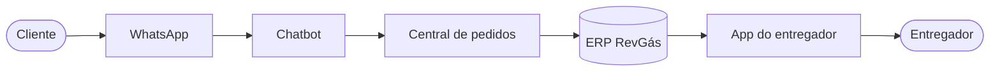
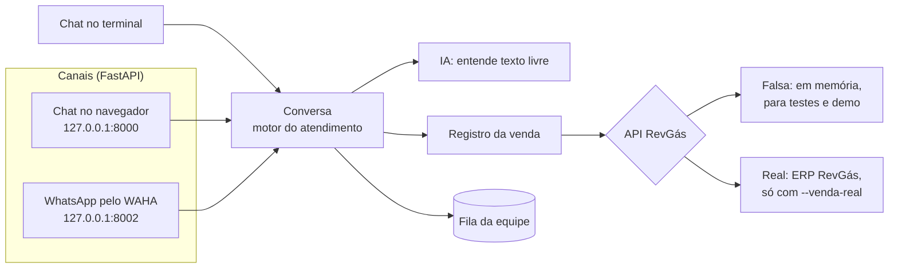

<div align="center">

# 🔥 Chatbot RevGás

**Inteligência artificial no atendimento do mercado de gás de cozinha (GLP).**<br/>
Do pedido no WhatsApp até a venda registrada no ERP RevGás.


[Sobre](#-sobre) · [Como rodar](#-como-rodar) · [Demonstração](#-roteiro-de-demonstração) · [WhatsApp](#-whatsapp-pelo-chip-waha) · [Arquitetura](#arquitetura)

</div>

---

<details>
<summary><b>📑 Sumário</b></summary>

1. [Sobre](#-sobre)
2. [Destaques](#-destaques)
3. [Como funciona](#-como-funciona): pedido e devolução
4. [Como rodar](#-como-rodar): pré-requisitos, instalação, `.env` e testes
5. [Formas de conversar](#-formas-de-conversar)
   - [Chat no terminal](#-chat-no-terminal)
   - [Chat no navegador](#-chat-no-navegador)
   - [WhatsApp pelo chip (WAHA)](#-whatsapp-pelo-chip-waha)
6. [Roteiro de demonstração](#-roteiro-de-demonstração)
7. [Venda real no ERP](#-venda-real-no-erp)
8. [Por dentro do projeto](#-por-dentro-do-projeto): arquitetura, tecnologias e pastas
9. [Equipe](#-equipe)

</details>

## 📌 Sobre

O **Chatbot RevGás** automatiza o atendimento aos clientes das revendas de GLP. O cliente faz o pedido numa conversa pelo WhatsApp, e o chatbot coleta os dados e registra a venda direto no **ERP RevGás**. Quando necessário, o atendimento passa para uma pessoa.

> Projeto desenvolvido na disciplina **Projeto de Extensão VI (Transformação Digital, 2026.2)**.

### Objetivos

- Reduzir o atendimento manual nas revendas
- Agilizar o registro de pedidos
- Melhorar a experiência do cliente
- Manter o atendimento humano disponível quando necessário

## ✨ Destaques

<table>
<tr>
<td width="50%" valign="top">

### 🛒 Pedido completo na conversa
Nome, produto, quantidade, endereço e pagamento, uma pergunta por vez. Só registra a venda depois que o cliente confirma o resumo.

</td>
<td width="50%" valign="top">

### 🧠 IA que entende texto livre
*"manda 2 botijão pra Rua Nova 10, pago no pix"* vira pedido. A IA só entende: preço e endereço são sempre conferidos pelo chatbot.

</td>
</tr>
<tr>
<td width="50%" valign="top">

### 🙋 Uma pessoa sempre ao alcance
"quero falar com um atendente" ou "cheiro de gás" abre uma solicitação na fila da equipe, e o vazamento chega como **URGENTE**.

</td>
<td width="50%" valign="top">

### 🛡️ Seguro por padrão
Servidores só nesta máquina, mensagens do WhatsApp com assinatura conferida, nada da conversa no log e venda real só quando você liga.

</td>
</tr>
</table>

## 🧭 Como funciona



### 🛒 Pedido

O chatbot identifica o cliente e coleta **nome, produto, telefone, endereço e forma de pagamento**. Depois mostra um resumo para o cliente confirmar e só então registra o pedido.

### ↩️ Devolução

O cliente pede cancelamento, troca por problema no produto ou devolução de valor com as próprias palavras ("quero cancelar", "veio com lacre violado", "paguei duas vezes"). O chatbot mostra até 3 pedidos dos últimos 7 dias, pergunta o motivo (e, se houver valor a devolver, se prefere crédito ou dinheiro de volta), mostra um resumo para o cliente confirmar e abre uma solicitação `DEV-…` na fila.

> [!IMPORTANT]
> O chatbot **só lê** o ERP: nunca cancela, nunca devolve dinheiro e nunca pede chave PIX ou dados bancários. Quem decide é a equipe.

- "Cheiro de gás" ou "veio vazando" seguem sempre o caminho do vazamento (orientações de segurança e URGENTE).
- No meio de um pedido, qualquer pedido de devolução pergunta antes se o cliente quer continuar este pedido, desistir dele ou falar de um pedido já feito: nada é descartado sem ele escolher.
- Os pedidos só aparecem para o número do próprio cliente. Com `--venda-real`, aparecem os do cliente de demonstração.

> [!NOTE]
> As orientações de segurança para vazamento (`config/seguranca.txt`) são provisórias e ainda serão validadas com a revenda.

## 🚀 Como rodar

### Pré-requisitos

| Para usar | Precisa de |
|---|---|
| Testes, chat no terminal e no navegador | Python 3.12+ e [uv](https://docs.astral.sh/uv/) |
| IA (texto livre) | Chave do Gemini no `.env` |
| WhatsApp pelo chip | Docker Desktop e um chip separado |
| Venda real no ERP | Chave da API RevGás e o cliente de demonstração (`REVGAS_CLIENTE_DEMO`) no `.env` |

### Instalação

```bash
git clone https://github.com/DEVsavin/ChatBot---RevGas.git
cd ChatBot---RevGas
uv sync
```

### Arquivo `.env`

O chat de teste funciona sem configuração nenhuma. As chaves só são necessárias para a IA, o WhatsApp e a venda real. Crie o arquivo a partir do exemplo e preencha o que for usar:

```bash
cp .env.example .env
```

| Variável | Para quê |
|---|---|
| `GEMINI_API_KEY` | IA que entende texto livre (opcional) |
| `REVGAS_API_KEY`, `REVGAS_API_URL`, `REVGAS_CLIENTE_DEMO` | Venda real no ERP (só com `--venda-real`) |
| `WHATSAPP_NUMEROS_EQUIPE` | Até 5 celulares da equipe, separados por vírgula: só eles (e os números fictícios) usam a IA |
| `WAHA_URL`, `WAHA_SESSAO`, `WAHA_API_KEY`, `WAHA_HMAC_KEY`, `WAHA_DASHBOARD_USERNAME`, `WAHA_DASHBOARD_PASSWORD`, `WAHA_ATENDER` | WhatsApp pelo chip (WAHA); veja a seção [WhatsApp pelo chip](#-whatsapp-pelo-chip-waha) |

> [!IMPORTANT]
> O `.env` está no `.gitignore` e **nunca** deve ser enviado ao repositório.

### Testes

```bash
uv run pytest
```

> [!NOTE]
> Os testes usam a API RevGás falsa e uma IA falsa: não acessam a internet e não precisam do `.env`.

## 💬 Formas de conversar

O mesmo atendimento roda em três lugares: no terminal, no navegador e no WhatsApp. As regras são as mesmas nos três.

### 💻 Chat no terminal

```bash
uv run python -m revgas_chatbot.canais.chat_terminal --telefone 5500900000001
```

- `--telefone` simula o número que o WhatsApp entregaria. Sem ele, o chat pergunta qual usar.
- Por padrão o chat usa uma **API de teste** (nenhuma venda vai para o ERP de verdade) com clientes fictícios de DDD `00`. Para vendas reais, veja a seção [Venda real no ERP](#-venda-real-no-erp).
  - `5500900000001`: cliente cadastrado (Maria Exemplo, com endereço);
  - `5500900000002`: cliente sem cadastro.
- As solicitações para a equipe ficam em `dados/fila.html` (abra no navegador e recarregue com F5). A pasta `dados/` não vai para o git.
- `Ctrl+D` sai do chat.

#### Com IA (texto livre)

Com a chave do Gemini (cota grátis do [Google AI Studio](https://aistudio.google.com/)) no arquivo `.env` (`GEMINI_API_KEY=...`), o chat entende frases como *"manda 2 botijão pra Rua Nova 10, Centro, Teresina-PI, pago no pix"*:

```bash
uv run --env-file .env python -m revgas_chatbot.canais.chat_terminal --telefone 5500900000001
```

- A IA só **entende** a mensagem; o chatbot confere tudo (preço do catálogo, endereço que o cliente disse) e o resumo continua obrigatório.
- Sem a chave, sem internet ou se a IA não responder em 8 segundos, o chat segue o roteiro normal.
- Na cota grátis o Google pode usar as mensagens: por isso a IA só atende os números fictícios (DDD `00`) e os da equipe (`WHATSAPP_NUMEROS_EQUIPE`). Para clientes reais será preciso um plano pago.

### 🌐 Chat no navegador

```bash
uv run python -m revgas_chatbot.canais.canal_web                      # sem IA
uv run --env-file .env python -m revgas_chatbot.canais.canal_web      # com IA
```

Abra **http://127.0.0.1:8000**, digite um telefone de demonstração e converse. A fila da equipe fica em **http://127.0.0.1:8000/fila** (recarregue para atualizar).

- Funciona **só nesta máquina** (`127.0.0.1`); outros computadores não acessam.
- Números fictícios (DDD `00`) são tratados como o número do cliente: a cliente cadastrada é reconhecida e a IA pode ser usada.
- Qualquer outro número é tratado como digitado: o chatbot pede nome e endereço, não mostra nenhum cadastro e só usa a IA se for um número da equipe.
- `--porta 8080` muda a porta, se a 8000 estiver ocupada.

### 📲 WhatsApp pelo chip (WAHA)

O chatbot atende pelo WhatsApp de um **chip comum**, usando o [WAHA](https://waha.devlike.pro/) (WhatsApp HTTP API) num contêiner Docker. O WAHA e o chatbot rodam só nesta máquina (`127.0.0.1:3000` e `127.0.0.1:8002`).

> [!WARNING]
> O WAHA não é a API oficial do WhatsApp: use um **chip separado**, que possa ser bloqueado sem prejuízo.

#### Passo a passo

1. **Abra o Docker Desktop** e espere aparecer "Docker is running" (ou o ícone ficar verde).
2. **Rode um comando**, na pasta do projeto:
   ```bash
   ./scripts/whatsapp-waha.sh
   ```
   Na primeira vez ele baixa a imagem do WAHA (alguns minutos). Ele mostra três etapas e, no fim, **"OK: o WAHA alcança o chatbot."** Se aparecer "ATENÇÃO: o WAHA NÃO alcança o chatbot", veja o plano B abaixo.
3. **Leia o QR code:** abra **http://127.0.0.1:3000/dashboard** no navegador. O usuário e a senha estão no `.env` (`WAHA_DASHBOARD_USERNAME` e `WAHA_DASHBOARD_PASSWORD`). Na sessão `default`, quando o status for `SCAN_QR_CODE`, clique no ícone da câmera e leia o código com o celular do chip (WhatsApp → **Aparelhos conectados** → **Conectar um aparelho**). O status muda para `WORKING`.
4. **Teste:** de um celular da equipe (listado em `WHATSAPP_NUMEROS_EQUIPE`), mande "oi" para o número do chip. Chegam a saudação e "Este número é seu?". Faça um pedido completo até "Pedido registrado!".
5. **Para desligar:** `Ctrl+C` no terminal desliga o chatbot. O WAHA continua no Docker (e o QR não é pedido de novo); para desligá-lo também:
   ```bash
   docker compose -f docker-compose.waha.yml down
   ```

#### Como ele se comporta

- **Quem é atendido:** com `WAHA_ATENDER=equipe` (padrão), só os números de `WHATSAPP_NUMEROS_EQUIPE`; mensagens de outros contatos do chip são ignoradas, sem resposta. `WAHA_ATENDER=todos` atende qualquer número (por exemplo, para o professor testar), mas a IA continua só para a equipe e o `--venda-real` não funciona nesse modo.
- **Nunca responde:** grupos, status, canais, mensagens do próprio chip e mensagens com mais de 10 minutos (ao reconectar, o WhatsApp pode entregar mensagens antigas).
- **Segurança:** cada mensagem que o WAHA envia ao chatbot é assinada (`WAHA_HMAC_KEY`); sem assinatura válida, é recusada. O painel do WAHA pede usuário e senha, e a API dele pede `WAHA_API_KEY`.
- **A sessão do WhatsApp** fica em `dados/waha-sessoes` (fora do git). Essa pasta dá acesso ao WhatsApp do chip: não compartilhe. Para desconectar o chip de vez, desligue o WAHA e apague a pasta.
- **Venda real:** `./scripts/whatsapp-waha.sh --venda-real` (veja a seção [Venda real no ERP](#-venda-real-no-erp)).

<details>
<summary><b>🆘 Se o WAHA não alcançar o chatbot (plano B)</b></summary>

O WAHA, dentro do Docker, chama o chatbot pelo endereço `host.docker.internal:8002`. Isso funciona no Docker Desktop; se a checagem do passo 2 falhar, as mensagens não chegam. Nesse caso:

1. Confira se é o **Docker Desktop** que está rodando (não o Docker "puro" do Linux) e rode o comando de novo.
2. Se continuar falhando, o plano B é rodar o chatbot também dentro do Docker, no mesmo compose do WAHA. Peça à equipe do projeto; enquanto isso, a demonstração pode ser feita pelo **chat no navegador**.

</details>

## 🎬 Roteiro de demonstração

Pelo chat no terminal (ou no navegador, digitando o mesmo telefone):

| # | Cenário | O que digitar |
|---|---|---|
| 1 | **Pedido completo** (cliente cadastrado) | `--telefone 5500900000001` → `sim` → `2` (quantidade) → `sim` (endereço do cadastro) → `1` (PIX) → `1` (confirmar) |
| 2 | **Cliente novo com correção** | `--telefone 5500900000002` → `sim` → nome → `1` (quantidade) → rua, número, bairro, cidade, `pular`, `pular` (o estado vem sozinho: Piauí; Timon, Maranhão) → `2` (dinheiro) → troco `200` → no resumo, `2` (corrigir) → `2` (endereço) → endereço novo → `1` (confirmar) |
| 2b | **Tudo numa mensagem** | `--telefone 5500900000002` → `sim` → nome → `2, Rua das Flores 123, Centro, Teresina, Pix` → resumo direto → `1` (confirmar). Com dinheiro: `1, Rua Nova 45, Centro, Teresina, Dinheiro, troco para R$ 200,00` |
| 3 | **Transferência para a equipe** | Em qualquer momento, `quero falar com um atendente` ou `estou sentindo cheiro de gás`; a solicitação aparece em `dados/fila.html` (o vazamento como URGENTE, no topo) |
| 4 | **Cancelamento** | Depois do cenário 1, na mesma conversa: `quero cancelar` → `1` (o pedido) → `1` (desisti) → `não` (ainda não pagou) → `1` (confirmar). Sai o protocolo `DEV-…` |
| 5 | **Problema no produto** | Depois do cenário 1: `veio com lacre violado` → `1` (o pedido) → `1` (confirmar). A solicitação entra na fila como **ALTA** |
| 6 | **Cobrança errada** | Depois do cenário 1: `paguei duas vezes` → `1` (o pedido) → `2` (dinheiro de volta) → `1` (confirmar) |

## 🧾 Venda real no ERP

Por padrão, todos os canais usam a API de teste. Com a opção `--venda-real`, cada pedido confirmado pelo cliente cria uma venda de verdade no ERP RevGás (estabelecimento 2580):

```bash
uv run --env-file .env python -m revgas_chatbot.canais.chat_terminal --venda-real
uv run --env-file .env python -m revgas_chatbot.canais.canal_web --venda-real
./scripts/whatsapp-waha.sh --venda-real
```

> [!CAUTION]
> Com `--venda-real`, cada pedido confirmado vira uma venda de verdade no ERP. O programa mostra o aviso `VENDA REAL LIGADA` ao iniciar (e a página web também avisa).

- Precisa de `REVGAS_API_KEY`, `REVGAS_API_URL` e `REVGAS_CLIENTE_DEMO` no `.env`; sem eles, o programa não inicia.
- Toda venda usa o cliente de demonstração de `REVGAS_CLIENTE_DEMO`, porque a chave atual ainda não tem acesso à busca de clientes da API.
- As vendas são criadas **sem avisar os entregadores**.
- `--avisar-entregadores` (só junto com `--venda-real`) faz cada venda **avisar os entregadores de verdade** do estabelecimento (broadcast `NEW_SALE`). O programa pede para digitar `AVISAR` antes de ligar. Use só com autorização (professor ou RevGás).
- A API limita a 1 requisição por segundo; o chatbot respeita esse limite.

Para cancelar as vendas abertas da demonstração depois de um teste (o script pede confirmação a cada uma):

```bash
uv run --env-file .env python -m revgas_chatbot.vendas.venda_de_teste --cancelar-demo
```

## 🔍 Por dentro do projeto

### Arquitetura



- **Canais:** cada forma de falar com o cliente é um pequeno servidor **FastAPI** (ligado pelo **uvicorn**) que só leva e traz texto. Todos escutam apenas em `127.0.0.1` e não registram as mensagens no log. O chat no terminal faz o mesmo papel, sem servidor.
- **Conversa:** o motor do atendimento ([`src/revgas_chatbot/conversa/`](src/revgas_chatbot/conversa/)). Não sabe de qual canal veio a mensagem; por isso trocar de canal não muda as regras.
- **IA:** só **entende** o que o cliente escreveu ([`src/revgas_chatbot/ia/`](src/revgas_chatbot/ia/)). Preço, endereço e confirmação são sempre conferidos pelo chatbot.
- **API RevGás:** há duas versões com a mesma "tomada" ([`src/revgas_chatbot/api_revgas/`](src/revgas_chatbot/api_revgas/)):
  - **falsa** (`ApiRevGasFalsa`): uma classe Python que guarda clientes e vendas na memória e imita as respostas do ERP. Não é um servidor nem usa FastAPI. É a padrão, nos testes e na demonstração;
  - **real** (`ApiRevGasHttp`): chama `https://api.revgas.com/v1`. Só é usada quando o comando recebe `--venda-real`.
- **Fila da equipe:** quando o atendimento passa para uma pessoa, a solicitação vai para `dados/` (fora do git), com página em `dados/fila.html`.
- **Montagem:** [`src/revgas_chatbot/montagem.py`](src/revgas_chatbot/montagem.py) é o único lugar que liga as peças e escolhe a API falsa ou a real.

### Tecnologias

| | Tecnologia | Para quê |
|---|---|---|
| 🐍 | **Python 3.12+** e **[uv](https://docs.astral.sh/uv/)** | Linguagem, ambiente e dependências |
| ⚡ | **FastAPI** e **uvicorn** | Servidores dos canais |
| 🌐 | **httpx** | Chamadas às APIs externas (ERP RevGás, Gemini e WAHA) |
| 🧪 | **pytest** | Testes automatizados |
| 🧠 | **Gemini** (Google AI Studio, cota grátis) | IA que entende texto livre |
| 🐳 | **WAHA** no **Docker** | WhatsApp pelo chip |

### Estrutura de pastas

```text
config/                  catálogo com preços, formas de pagamento e orientações de vazamento
scripts/
└── whatsapp-waha.sh     liga o WAHA no Docker e o chatbot com um comando
src/revgas_chatbot/
├── canais/              terminal, navegador e WhatsApp (WAHA)
├── conversa/            motor do atendimento e regras do que o cliente digita
├── ia/                  interpretação de texto livre (Gemini) e sua validação
├── vendas/              pedido, validação, registro da venda e script da venda de teste
├── api_revgas/          API RevGás: interface, versão falsa, versão real e limite de 1 req/s
├── atendimento/         fila de solicitações para a equipe e sua página
├── devolucao/           pedidos do cliente e solicitações de cancelamento, troca e devolução de valor
└── montagem.py          liga as peças e escolhe a API falsa ou a real
tests/                   testes, na mesma divisão de pastas do código
docker-compose.waha.yml  contêiner do WAHA
```

## 👥 Equipe

<table>
<tr>
<td align="center"><b>Sávio Macêdo</b></td>
<td align="center"><b>Bruno Moraes</b></td>
<td align="center"><b>Matheus Farias</b></td>
</tr>
</table>

---

<div align="center">
<sub>🔥 Projeto de Extensão VI · Transformação Digital · 2026.2</sub>
</div>
