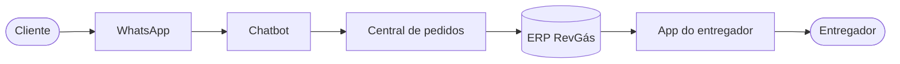

<div align="center">

# 🔥 Chatbot RevGás

**Inteligência artificial no atendimento do mercado de gás de cozinha (GLP).**


</div>

---

## 📌 Sobre

O **Chatbot RevGás** automatiza o atendimento aos clientes das revendas de GLP. O cliente faz o pedido numa conversa pelo WhatsApp, e o chatbot coleta os dados e registra a venda direto no **ERP RevGás**. Quando necessário, o atendimento passa para uma pessoa.

> Projeto desenvolvido na disciplina **Projeto de Extensão VI (Transformação Digital, 2026.2)**.

## 🎯 Objetivos

- Reduzir o atendimento manual nas revendas
- Agilizar o registro de pedidos
- Melhorar a experiência do cliente
- Manter o atendimento humano disponível quando necessário

## 💬 Como funciona



O chatbot identifica o cliente e coleta **nome, produto, telefone, endereço e forma de pagamento**. Depois mostra um resumo para o cliente confirmar e só então registra o pedido.

## 🚀 Como rodar

Requisitos: Python 3.12+ e [uv](https://docs.astral.sh/uv/).

```bash
git clone https://github.com/DEVsavin/ChatBot---RevGas.git
cd ChatBot---RevGas
uv sync
uv run pytest
```

## 🗨️ Chat de teste (terminal)

```bash
uv run python -m revgas_chatbot.chat_terminal --telefone 5500900000001
```

- `--telefone` simula o número que o WhatsApp entregaria. Sem ele, o chat pergunta qual usar.
- Nesta versão o chat usa uma **API de teste** (nenhuma venda vai para o ERP de verdade) com clientes fictícios de DDD `00`:
  - `5500900000001`: cliente cadastrado (Maria Exemplo, com endereço);
  - `5500900000002`: cliente sem cadastro.
- As solicitações para a equipe ficam em `dados/fila.html` (abra no navegador e recarregue com F5). A pasta `dados/` não vai para o git.
- `Ctrl+D` sai do chat.

### Com IA (texto livre)

Com a chave do Gemini (cota grátis do [Google AI Studio](https://aistudio.google.com/)) no arquivo `.env` (`GEMINI_API_KEY=...`), o chat entende frases como *"manda 2 botijão pra Rua Nova 10, Centro, Teresina-PI, pago no pix"*:

```bash
uv run --env-file .env python -m revgas_chatbot.chat_terminal --telefone 5500900000001
```

- A IA só **entende** a mensagem; o chatbot confere tudo (preço do catálogo, endereço que o cliente disse) e o resumo continua obrigatório.
- Sem a chave, sem internet ou se a IA não responder em 8 segundos, o chat segue o roteiro normal.
- Na cota grátis o Google pode usar as mensagens: por isso a IA só funciona com a API de teste e os clientes fictícios. Para clientes reais será preciso um plano pago.

### Roteiro de demonstração

1. **Pedido completo (cliente cadastrado):** `--telefone 5500900000001` → `sim` → `1` (botijão) → `2` (quantidade) → `sim` (endereço do cadastro) → `1` (PIX) → `1` (confirmar).
2. **Cliente novo com correção:** `--telefone 5500900000002` → `sim` → nome → `1` → `1` → rua, número, bairro, cidade, estado, `pular`, `pular` → `2` (dinheiro) → troco `200` → no resumo, `2` (corrigir) → `2` (endereço) → endereço novo → `1` (confirmar).
3. **Transferência para a equipe:** em qualquer momento, envie `quero falar com um atendente` ou `estou sentindo cheiro de gás` e veja a solicitação em `dados/fila.html` (o vazamento aparece como URGENTE, no topo).

> As orientações de segurança para vazamento (`config/seguranca.txt`) são provisórias e ainda serão validadas com a revenda.

## 👥 Equipe

- Sávio Macêdo
- Bruno Moraes
- Matheus Farias
