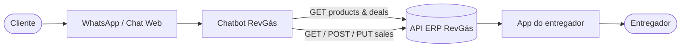
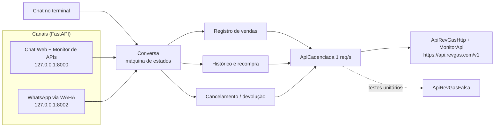

<div align="center">

# 🔥 Chatbot RevGás

**Atendimento automático no WhatsApp para o mercado de gás de cozinha (GLP).**<br/>
Do pedido no WhatsApp até a venda registrada no ERP RevGás — consumindo 100% as APIs reais da RevGás.


[Sobre](#-sobre) · [APIs consumidas](#-apis-revgás-consumidas) · [Como rodar](#-como-rodar) · [Demonstração](#-roteiro-de-demonstração) · [WhatsApp](#-whatsapp-pelo-chip-waha) · [Arquitetura](#arquitetura)

</div>

---

<details>
<summary><b>📑 Sumário</b></summary>

1. [Sobre](#-sobre)
2. [Destaques](#-destaques)
3. [APIs RevGás consumidas](#-apis-revgás-consumidas)
4. [Como funciona](#-como-funciona): pedido, acompanhamento, histórico e devolução
5. [Como rodar](#-como-rodar): pré-requisitos, instalação, `.env` e testes
6. [Formas de conversar](#-formas-de-conversar)
   - [Chat no navegador + Monitor de APIs](#-chat-no-navegador--monitor-de-apis-em-tempo-real)
   - [Chat no terminal](#-chat-no-terminal)
   - [WhatsApp pelo chip (WAHA)](#-whatsapp-pelo-chip-waha)
7. [Roteiro de demonstração](#-roteiro-de-demonstração)
8. [Venda real no ERP](#-venda-real-no-erp)
9. [Por dentro do projeto](#-por-dentro-do-projeto): arquitetura, tecnologias e pastas
10. [Equipe](#-equipe)

</details>

## 📌 Sobre

O **Chatbot RevGás** automatiza o atendimento aos clientes das revendas de GLP. O cliente conversa pelo WhatsApp (ou pelo simulador web/terminal), e o chatbot consulta o catálogo real, verifica o histórico do cliente, coleta os dados do pedido e registra a venda diretamente na **API oficial do ERP RevGás** — sem banco de dados local, sem fila local e sem dependência de LLM.

> Projeto desenvolvido na disciplina **Projeto de Extensão VI (Transformação Digital, 2026.2)**.

### Objetivos

- Reduzir o atendimento manual nas revendas
- Consumir diretamente as APIs reais do ERP RevGás em todas as etapas
- Agilizar o registro, acompanhamento e repetição de pedidos
- Manter o atendimento humano disponível quando necessário

## ✨ Destaques

<table>
<tr>
<td width="50%" valign="top">

### 🛒 Pedido rápido, uma pergunta por vez
Captura automática do telefone do cliente, identificação/cadastro automático no ERP, catálogo real de GLP e reguladores com **múltiplos itens no mesmo pedido**, endereço com **Quadra** opcional e cidade/estado automáticos (`Teresina, Piauí`), botão `0) Não tem / Pular etapa`, pagamento em **PIX** (*Pagar agora* ou *Pagar na entrega*), **Dinheiro** (com troco), **Cartão** (débito/crédito) e **Vale-gás** (código de 7 dígitos com troca rápida de pagamento se inválido).

</td>
<td width="50%" valign="top">

### 📡 100% API Real + Painel em Tempo Real
Sem banco local e sem mocks em produção: catálogo, preços, histórico, criação de vendas e anotações de pós-venda vão direto para `https://api.revgas.com/v1`. O chat web inclui um **Monitor de APIs em tempo real** que exibe cada chamada `GET`/`POST`/`PUT`, status HTTP, latência e JSON enviado/recebido.

</td>
</tr>
<tr>
<td width="50%" valign="top">

### 🧠 Máquina de estados determinística (sem IA)
Regras claras e previsíveis: o mesmo texto sempre produz a mesma resposta. Preços vêm direto do ERP, o último pedido pode ser repetido com 1 clique, o endereço anterior é reaproveitado automaticamente em novos pedidos e o resumo antes de confirmar é obrigatório.

</td>
<td width="50%" valign="top">

### 🛡️ Seguro por padrão
Servidores escutam apenas em `127.0.0.1`, chave da API nunca exposta na interface ou logs, isolamento de histórico por hash anônimo do telefone (`[tel:…]`), webhooks do WhatsApp assinados via HMAC e orientações imediatas para **vazamento de gás**.

</td>
</tr>
</table>

## 📡 APIs RevGás consumidas

No modo `--venda-real`, todas as operações consomem diretamente a API oficial em `https://api.revgas.com/v1` (respeitando o limite global de **1 requisição/segundo** via `ApiCadenciada`):

| Método | Endpoint | Uso no Chatbot |
|---|---|---|
| `GET` | `/v1/customers` | Identifica cliente real pelo telefone (com fallback automático de 9º dígito), trazendo nome, endereço e coordenadas |
| `POST` | `/v1/customers` | Cadastra automaticamente cliente novo ao confirmar o primeiro pedido |
| `GET` | `/v1/customers/{id}` | Detalha cadastro de um cliente específico |
| `PUT` | `/v1/customers/{id}` | Atualiza automaticamente endereço/nome do cliente no ERP quando alterado no pedido |
| `GET` | `/v1/products` | Carrega os produtos ativos em estoque do estabelecimento (filtrados para GLP, botijões, vasilhames, reguladores e mangueiras) |
| `GET` | `/v1/deals` | Busca os preços vigentes de tabela para montar o catálogo real |
| `GET` | `/v1/sales` | Consulta o histórico recente de pedidos do cliente (`meus pedidos`, `status`, repetir último pedido e devolução/cancelamento) |
| `GET` | `/v1/sales/{id}` | Busca os detalhes atualizados de um pedido específico (status, entregador, previsão, forma de pagamento) |
| `POST` | `/v1/sales` | Registra a venda confirmada (incluindo múltiplos itens em `products[]`) no ERP RevGás |
| `PUT` | `/v1/sales/{id}` | Registra solicitações de cancelamento, troca/problema ou devolução diretamente na `observation` da venda (protocolo `ERP-{id}`) |

## 🧭 Como funciona



### 🛒 Pedido e Recompra
- A conversa começa limpa (como no WhatsApp real): o chatbot só responde após a primeira mensagem do cliente (`oi`, `quero gás`, etc.) e identifica automaticamente o telefone do canal.
- Se o cliente já tiver um pedido recente na API RevGás, o chatbot oferece **repetir o último pedido** (atualizando o preço pelo catálogo vigente).
- Se o cliente escolher fazer outro pedido, o último endereço é **reaproveitado automaticamente** e já aparece formatado no resumo — bastando escolher `2) Corrigir` caso queira entregar em outro endereço.
- O pedido só é enviado (`POST /v1/sales`) depois que o cliente escolhe `1) Confirmar` no resumo.

### 📦 Meus Pedidos e Acompanhamento
- `meus pedidos` → lista os pedidos recentes daquele número direto da API (`GET /v1/sales`).
- `status` ou `"onde está meu pedido?"` → consulta os detalhes do pedido (`GET /v1/sales/{id}`) e informa a situação atual da entrega.

### ↩️ Cancelamento, Troca e Devolução
- O cliente pode escrever com as próprias palavras (`"quero cancelar"`, `"veio com lacre violado"`, `"paguei duas vezes"`).
- O chatbot consulta os pedidos dos últimos 7 dias (`GET /v1/sales`), coleta o motivo e registra a solicitação diretamente na `observation` da venda via `PUT /v1/sales/{id}`, gerando o protocolo `ERP-{id}` para a equipe.
- Mensagens como `"cheiro de gás"` ou `"vazamento"` têm prioridade máxima em qualquer etapa e disparam imediatamente as orientações de segurança (`config/seguranca.txt`).

## 🚀 Como rodar

### Pré-requisitos

| Para usar | Precisa de |
|---|---|
| Testes, chat no terminal e chat web | Python 3.12+ (e opcionalmente [uv](https://docs.astral.sh/uv/)) |
| Integração real com o ERP RevGás | `REVGAS_API_KEY`, `REVGAS_API_URL` e `REVGAS_CLIENTE_DEMO` no `.env` |
| WhatsApp pelo chip | Docker Desktop e um chip separado |

### Instalação

```bash
git clone https://github.com/DEVsavin/ChatBot---RevGas.git
cd ChatBot---RevGas
uv sync
```

*(Ou com `pip`: `pip install -e .`)*

### Arquivo `.env`

Crie o arquivo `.env` a partir do modelo e preencha as credenciais da API RevGás:

```bash
cp .env.example .env
```

| Variável | Para quê |
|---|---|
| `REVGAS_API_KEY` | Token de autorização da API RevGás (`https://api.revgas.com/v1`) |
| `REVGAS_API_URL` | URL base da API (`https://api.revgas.com/v1`) |
| `REVGAS_CLIENTE_DEMO` | ID do cliente de demonstração usado no modo `--venda-real` (estabelecimento `2580`) |
| `WHATSAPP_NUMEROS_EQUIPE` | Até 5 celulares da equipe, separados por vírgula (quando `WAHA_ATENDER=equipe`) |
| `WAHA_URL`, `WAHA_SESSAO`, `WAHA_API_KEY`, `WAHA_HMAC_KEY`, `WAHA_DASHBOARD_USERNAME`, `WAHA_DASHBOARD_PASSWORD`, `WAHA_ATENDER` | Integração com WhatsApp pelo chip via WAHA |

> [!IMPORTANT]
> O `.env` está no `.gitignore` e **nunca** deve ser enviado ao repositório.

### Testes

```bash
uv run pytest
```

## 💬 Formas de conversar

O mesmo motor de conversa roda em três canais: navegador, terminal e WhatsApp.

### 🌐 Chat no navegador + Monitor de APIs em tempo real

```bash
uv run --env-file .env python -m revgas_chatbot.canais.canal_web --venda-real
```

Abra **http://127.0.0.1:8000** no navegador:
- **Esquerda (Chat estilo WhatsApp):** informe um telefone com DDD, clique em **Começar** e envie a primeira mensagem (`oi`). Opções numeradas (`1)`, `2)`, `0) Não tem / Pular etapa`) viram botões clicáveis.
- **Direita (APIs RevGás em tempo real):** mostra cada requisição HTTP (`GET`, `POST`, `PUT`), status, URL com parâmetros, latência em `ms` e o JSON enviado/recebido, atualizando automaticamente a cada interação.
- Escuta apenas em `127.0.0.1` (`--porta 8080` permite trocar a porta).

### 💻 Chat no terminal

```bash
uv run --env-file .env python -m revgas_chatbot.canais.chat_terminal --venda-real --telefone 5586999990001
```

- `--telefone` simula o número do WhatsApp. Sem `--venda-real`, usa a `ApiRevGasFalsa` em memória para testes offline.
- `Ctrl+D` encerra o chat.

### 📲 WhatsApp pelo chip (WAHA)

O chatbot também atende pelo WhatsApp de um **chip comum** usando o [WAHA](https://waha.devlike.pro/) em Docker (`127.0.0.1:3000` e `127.0.0.1:8002`).

> [!WARNING]
> O WAHA não é a API oficial do WhatsApp: use um **chip separado**, que possa ser bloqueado sem prejuízo.

1. Abra o **Docker Desktop**.
2. Rode na pasta do projeto:
   ```bash
   ./scripts/whatsapp-waha.sh --venda-real
   ```
3. Acesse **http://127.0.0.1:3000/dashboard** (usuário e senha do `.env`) e leia o QR code com o celular do chip.
4. Envie `"oi"` de um celular listado em `WHATSAPP_NUMEROS_EQUIPE`.
5. Para desligar o WAHA:
   ```bash
   docker compose -f docker-compose.waha.yml down
   ```

## 🎬 Roteiro de demonstração

Com `canal_web --venda-real` aberto em **http://127.0.0.1:8000**:

| # | Cenário | O que fazer e observar no Monitor de APIs |
|---|---|---|
| 1 | **Carregamento do catálogo real** | Ao iniciar o servidor, o painel já exibe `GET /v1/products` (`200`) e `GET /v1/deals` (`200`) com os itens reais de GLP e reguladores. |
| 2 | **Primeiro pedido completo** | Digite um telefone → clique em **Começar** → envie `oi` (`GET /v1/sales`) → informe nome → escolha produto e quantidade → informe rua, número (ou `0` para pular), quadra (opcional), bairro → escolha `1) PIX` → `1) Pagar agora` → `1) Confirmar` → observe `POST /v1/sales` (`201`) no painel. |
| 3 | **Recompra e reaproveitamento de endereço** | Recarregue a página (`F5`), use o **mesmo telefone** e envie `oi`: o chatbot consulta `GET /v1/sales` e oferece repetir o último pedido. Escolhendo `2) Não, fazer outro pedido`, ele já reaproveita o endereço anterior automaticamente. |
| 4 | **Isolamento entre números** | Recarregue (`F5`) com **outro telefone** e envie `oi`: o histórico vem separado por hash anônimo do telefone e não mistura pedidos de outro número. |
| 5 | **Meus pedidos e acompanhamento** | Envie `meus pedidos` ou `status` para consultar `GET /v1/sales` e `GET /v1/sales/{id}` em tempo real. |
| 6 | **Cancelamento / Devolução no ERP** | Envie `cancelar` → escolha o pedido → escolha o motivo → confirme → observe `GET /v1/sales/{id}` + `PUT /v1/sales/{id}` (`200`) gravando o protocolo `ERP-{id}` na venda. |
| 7 | **Vazamento de gás** | Em qualquer ponto, envie `estou sentindo cheiro de gás` para receber imediatamente as orientações de emergência. |

## 🧾 Venda real no ERP

```bash
uv run --env-file .env python -m revgas_chatbot.canais.canal_web --venda-real
uv run --env-file .env python -m revgas_chatbot.canais.chat_terminal --venda-real
./scripts/whatsapp-waha.sh --venda-real
```

> [!CAUTION]
> Com `--venda-real`, cada pedido confirmado cria uma venda de verdade no estabelecimento `2580` da API RevGás (sem disparar notificação para entregadores por padrão).

- `--avisar-entregadores` (junto com `--venda-real`) ativa o broadcast `NEW_SALE` real; exige confirmação digitando `AVISAR`.
- Para cancelar vendas de demonstração abertas após um teste:
  ```bash
  uv run --env-file .env python -m revgas_chatbot.vendas.venda_de_teste --cancelar-demo
  ```

## 🔍 Por dentro do projeto

### Arquitetura



### Tecnologias

| | Tecnologia | Para quê |
|---|---|---|
| 🐍 | **Python 3.12+** e **[uv](https://docs.astral.sh/uv/)** | Linguagem, ambiente e dependências |
| ⚡ | **FastAPI** e **uvicorn** | Servidores dos canais e endpoint `/api-logs` do monitor |
| 🌐 | **httpx** | Cliente HTTP para a API RevGás e WAHA |
| 🧪 | **pytest** | Testes automatizados |
| 🐳 | **WAHA** no **Docker** | Integração com WhatsApp pelo chip |

### Estrutura de pastas

```text
config/                  formas de pagamento, catálogo fallback e orientações de vazamento
scripts/
└── whatsapp-waha.sh     sobe o WAHA no Docker e inicia o chatbot
src/revgas_chatbot/
├── api_revgas/          cliente HTTP real (ApiRevGasHttp), MonitorApi, ApiCadenciada (1 req/s) e versão falsa para testes
├── atendimento/         utilitários de transferência para atendente e mascaramento de dados
├── canais/              chat web com monitor em tempo real (canal_web.py / pagina_chat.html), terminal e WAHA
├── conversa/            máquina de estados do atendimento, parser de entradas e estados brasileiros
├── devolucao/           fluxo de cancelamento, troca e devolução gravando direto via PUT /v1/sales/{id}
├── vendas/              catálogo real da API (catalogo_api.py), histórico (historico.py), pedido, validação e registro
└── montagem.py          ponto único de composição das dependências
tests/                   testes automatizados espelhando a estrutura de src/
docker-compose.waha.yml  contêiner do WAHA
```

## 👥 Equipe

<table>
<tr>
<td align="center"><b>Sávio Macêdo</b></td>
<td align="center"><b>Bruno Moraes</b></td>
<td align="center"><b>Matheus Farias</b></td>
</tr>
</table>

---

<div align="center">
<sub>🔥 Projeto de Extensão VI · Transformação Digital · 2026.2</sub>
</div>
